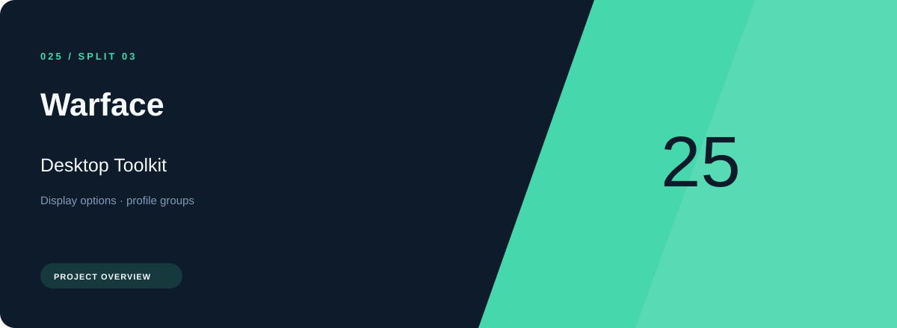
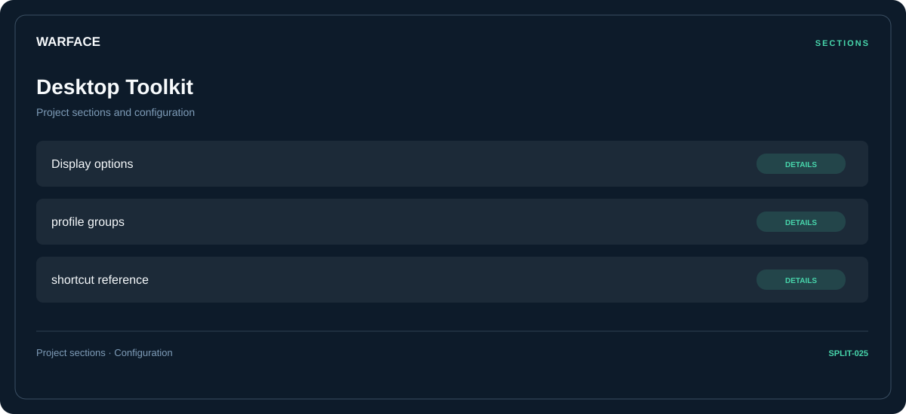

# 🎮 Warface Desktop Toolkit

**Display options · Profile groups · Shortcut reference**

## ⚡ Features

Warface Desktop Toolkit brings display options and profile groups into one section-based interface. Shortcut reference provides the third part of the workflow.

### ⚙️ Display options

Display or performance-related options, with space for configuration and comparison information.

### 🧩 Profile groups

Related settings collected into named groups for a clearer configuration workflow.

### ⌨️ Shortcut reference

Shortcut assignments and control mappings, organized in one reference section.

## 🖥️ Project navigation

## 📥 Download

The button and cover open the project's download page. Use the information supplied with the downloaded package for installation and release-specific requirements.

## 📚 Project documentation

- [Feature reference](docs/FEATURES.md)
- [Download information](docs/DOWNLOAD.md)
- [Project page](index.html)

---

Warface Desktop Toolkit · Program documentation and download information.
